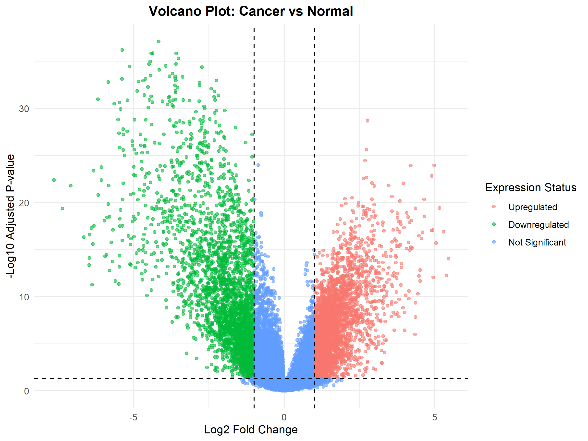
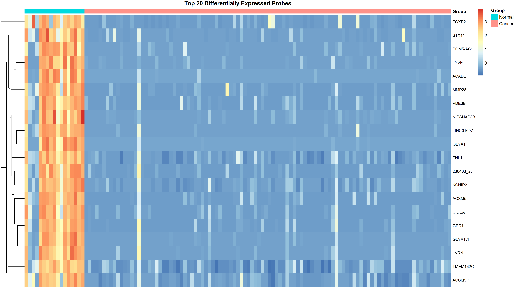
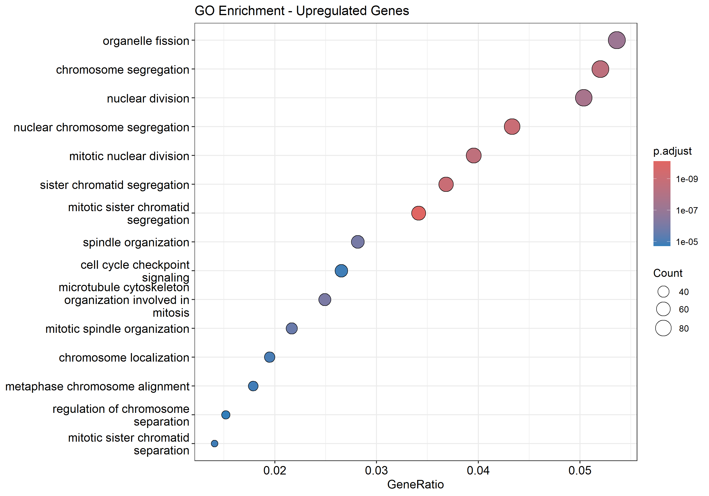
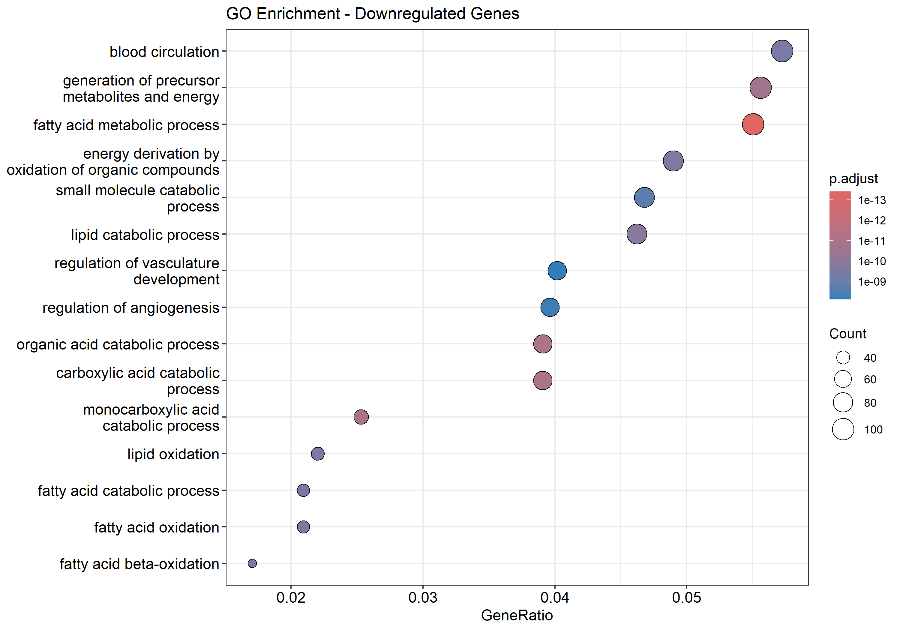

---
title: "Breast Cancer Gene Expression Analysis Using R"
author: "Pavani Rathwaththe"
date: "`r Sys.Date()`"
output:
  html_document:
    toc: true
    toc_depth: 3
    number_sections: true
    theme: readable
    code_folding: show
    df_print: paged
---

```{r setup, include=FALSE}
knitr::opts_chunk$set(
  echo = TRUE,
  warning = FALSE,
  message = FALSE,
  fig.align = "center",
  out.width = "90%"
)

library(ggplot2)
library(knitr)

# Load project results
all_results <- read.csv(
  "results/tables/all_differential_expression_results.csv"
)

significant_genes <- read.csv(
  "results/tables/significant_genes.csv"
)

up_go <- read.csv(
  "results/tables/upregulated_GO_enrichment.csv"
)

down_go <- read.csv(
  "results/tables/downregulated_GO_enrichment.csv"
)

sample_info <- read.csv(
  "data/sample_groups.csv"
)

# Summary statistics
total_samples <- nrow(sample_info)
normal_samples <- sum(sample_info$Group == "Normal", na.rm = TRUE)
cancer_samples <- sum(sample_info$Group == "Cancer", na.rm = TRUE)

total_probes <- nrow(all_results)
significant_probes <- nrow(significant_genes)

upregulated_probes <- sum(
  significant_genes$logFC > 0,
  na.rm = TRUE
)

downregulated_probes <- sum(
  significant_genes$logFC < 0,
  na.rm = TRUE
)
```

# Abstract

Breast cancer is one of the major health challenges affecting women worldwide. Gene expression analysis can help identify molecular differences between cancerous and normal breast tissue.

This project analyses the GSE42568 breast cancer gene expression dataset obtained from the NCBI Gene Expression Omnibus (GEO). R programming and bioinformatics packages were used to perform data preprocessing, quality control, differential expression analysis and Gene Ontology (GO) enrichment analysis.

The `limma` package was used to identify differentially expressed probes between cancer and normal samples. Significant probes were selected using an adjusted p-value below 0.05 and an absolute log2 fold change greater than 1.

Volcano plots, heatmaps and GO enrichment plots were generated to visualise the results. The findings provide an overview of gene expression differences and biological processes associated with breast cancer.

# Introduction

## Background

Breast cancer develops when abnormal cells in breast tissue grow and multiply uncontrollably. Changes in gene expression can be associated with cancer development and progression.

Bioinformatics provides computational methods to analyse biological data. Gene expression analysis is one such method used to compare the activity of genes across different biological conditions.

## Problem Statement

Understanding differences in gene expression between breast cancer and normal breast tissue is important for identifying genes and biological processes associated with the disease.

However, large gene expression datasets contain thousands of probes, making manual analysis difficult.

Therefore, computational analysis is required to identify significant expression differences and explore their biological functions.

## Aim

To analyse breast cancer gene expression data using R and identify differentially expressed probes and associated biological processes.

## Objectives

1. Obtain a public breast cancer gene expression dataset.
2. Perform data preprocessing and quality control.
3. Identify differentially expressed probes between cancer and normal samples.
4. Visualise differential expression results.
5. Perform Gene Ontology Biological Process enrichment analysis.
6. Summarise the main findings.

## Research Question

What gene expression differences and biological processes can be identified between breast cancer and normal breast tissue using the GSE42568 dataset?

# Dataset Description

## Data Source

The dataset used in this project is GSE42568, obtained from the NCBI Gene Expression Omnibus (GEO).

Dataset link:

https://www.ncbi.nlm.nih.gov/geo/query/acc.cgi?acc=GSE42568

## Dataset Information

| Attribute | Description |
|---|---|
| Dataset ID | GSE42568 |
| Data type | Gene expression |
| Platform | GPL570 |
| Technology | Affymetrix Human Genome U133 Plus 2.0 |
| Total samples | 121 |
| Normal samples | 17 |
| Cancer samples | 104 |
| Total probes | 54,675 |

## Sample Groups

The dataset contains two sample groups:

- Normal: Breast tissue samples classified as normal.
- Cancer: Breast cancer tissue samples.

The analysis compares gene expression between these two groups.

# Methodology

## Tools and Technologies

The following tools and packages were used:

| Tool / Package | Purpose |
|---|---|
| R | Statistical analysis |
| RStudio | Development environment |
| GEOquery | GEO dataset retrieval |
| limma | Differential expression analysis |
| ggplot2 | Data visualisation |
| pheatmap | Heatmap generation |
| hgu133plus2.db | Probe annotation |
| clusterProfiler | GO enrichment analysis |
| org.Hs.eg.db | Human gene annotation |
| enrichplot | Enrichment visualisation |

## Data Collection

The GSE42568 dataset was obtained from NCBI GEO.

The expression data and sample information were downloaded and stored locally for further analysis.

## Data Preprocessing

Data preprocessing was performed to prepare the expression matrix for analysis.

The sample information was matched with the expression matrix columns to ensure that each sample had the correct group label.

The samples were categorised into Normal and Cancer groups.

## Quality Control

Quality control was performed using visualisations to examine the expression data.

The following plots were used:

- Expression distribution plot.
- Expression density plot.
- Sample distribution plot.
- Sample correlation heatmap.
- Principal Component Analysis (PCA) plot.

These visualisations helped examine sample distributions and relationships before differential expression analysis.

## Differential Expression Analysis

The `limma` package was used to identify differentially expressed probes.

A linear model was fitted to the expression data.

The comparison was performed using:

**Cancer - Normal**

The Benjamini-Hochberg method was used to adjust p-values for multiple testing.

The following criteria were used to identify significant probes:

- Adjusted p-value < 0.05
- Absolute log2 fold change > 1

Probes with positive log2 fold changes were considered upregulated, while probes with negative log2 fold changes were considered downregulated.

## Gene Annotation

Probe IDs were mapped to gene symbols using the `hgu133plus2.db` annotation package.

This helped associate the identified probes with known gene symbols where annotation was available.

## Functional Enrichment Analysis

Gene Ontology (GO) Biological Process enrichment analysis was performed using `clusterProfiler`.

Upregulated and downregulated gene lists were analysed separately.

The Benjamini-Hochberg method was used for multiple-testing adjustment.

# Results

## Dataset Summary

```{r dataset-summary}
dataset_summary <- data.frame(
  Category = c(
    "Total samples",
    "Normal samples",
    "Cancer samples",
    "Total probes"
  ),
  Count = c(
    total_samples,
    normal_samples,
    cancer_samples,
    total_probes
  )
)

kable(
  dataset_summary,
  caption = "Dataset Summary"
)
```

## Differential Expression Results

```{r differential-summary}
differential_summary <- data.frame(
  Category = c(
    "Total probes",
    "Significant probes",
    "Upregulated probes",
    "Downregulated probes"
  ),
  Count = c(
    total_probes,
    significant_probes,
    upregulated_probes,
    downregulated_probes
  )
)

kable(
  differential_summary,
  caption = "Differential Expression Summary"
)
```

## Volcano Plot

The volcano plot shows the relationship between log2 fold change and adjusted p-values.

Upregulated and downregulated probes are highlighted separately from non-significant probes.

```{r volcano-plot, echo=FALSE}

```

*Figure 1: Volcano plot showing differentially expressed probes between cancer and normal samples.*

## Heatmap

The heatmap illustrates the expression patterns of the selected top differentially expressed probes across the samples.

Expression values were scaled row-wise to make relative expression patterns easier to compare.

```{r heatmap, echo=FALSE}

```

*Figure 2: Heatmap of the top 20 differentially expressed probes.*

## Top Differentially Expressed Probes

```{r top-probes}
top_results <- head(
  all_results[
    ,
    c(
      "Probe_ID",
      "Gene_Symbol",
      "logFC",
      "P.Value",
      "adj.P.Val"
    )
  ],
  10
)

kable(
  top_results,
  digits = 4,
  caption = "Top 10 Differentially Expressed Probes"
)
```

## GO Enrichment Results

GO Biological Process enrichment analysis was performed separately for upregulated and downregulated genes.

```{r go-summary}
go_summary <- data.frame(
  Category = c(
    "Upregulated GO terms",
    "Downregulated GO terms"
  ),
  Count = c(
    nrow(up_go),
    nrow(down_go)
  )
)

kable(
  go_summary,
  caption = "GO Enrichment Summary"
)
```

### Upregulated Biological Processes

The enriched biological processes among upregulated genes mainly included:

- Cell division.
- Chromosome segregation.
- Mitotic nuclear division.
- Spindle organisation.

These processes are associated with cell division and chromosome organisation.

```{r upregulated-go-plot, echo=FALSE}

```

*Figure 3: GO Biological Process enrichment results for upregulated genes.*

### Downregulated Biological Processes

The enriched biological processes among downregulated genes mainly included:

- Fatty acid metabolism.
- Lipid catabolism.
- Fatty acid beta-oxidation.
- Energy production.

These processes are associated with lipid metabolism and cellular energy production.

```{r downregulated-go-plot, echo=FALSE}

```

*Figure 4: GO Biological Process enrichment results for downregulated genes.*

# Discussion

The differential expression analysis identified differences between breast cancer and normal breast tissue samples.

The results showed that a number of probes were significantly differentially expressed based on the selected statistical criteria.

The upregulated biological processes were mainly related to cell division and chromosome organisation. These processes are important for normal cell growth and division, and their altered expression may be associated with cancer-related cellular activity.

The downregulated biological processes were mainly related to fatty acid metabolism and lipid breakdown. These findings suggest differences in metabolic activity between the two sample groups.

The results provide an overview of gene expression patterns and biological processes associated with breast cancer in this dataset.

However, the findings represent statistical associations and do not establish that the identified genes or biological processes directly cause breast cancer.

# Limitations

This project has several limitations:

1. The analysis used one public gene expression dataset.
2. The dataset contains a larger number of cancer samples than normal samples.
3. Some probes may not have available gene annotations.
4. Multiple probes may correspond to the same gene.
5. GO enrichment results depend on the selected gene lists and annotation database.
6. The findings were not experimentally validated.
7. The analysis identifies associations rather than causal relationships.

# Conclusion

This project demonstrated how R programming and bioinformatics tools can be used to analyse breast cancer gene expression data.

The GSE42568 dataset was used to compare normal and breast cancer samples.

Differential expression analysis identified significant expression differences between the two groups. Functional enrichment analysis highlighted biological processes related to cell division, chromosome organisation and lipid metabolism.

The project provided practical experience in data collection, preprocessing, statistical analysis, gene annotation, data visualisation and functional enrichment analysis.

Future work could include analysing additional breast cancer datasets, comparing results across independent datasets and validating selected genes using other biological resources.

# Reproducibility

The project source code and analysis results are available in the GitHub repository:

https://github.com/pavani2118/Breast-Cancer-Gene-Expression

The analysis scripts are organised in the `code` directory.

To reproduce the analysis:

1. Clone or download the GitHub repository.
2. Open the project in RStudio.
3. Install the required R packages.
4. Run the scripts in numerical order from `01_data_collection.R` to `06_results_summary.R`.
5. Open this R Markdown file and click Knit to generate the HTML report.

# References

1. NCBI Gene Expression Omnibus. GSE42568: Breast cancer gene expression dataset. https://www.ncbi.nlm.nih.gov/geo/query/acc.cgi?acc=GSE42568

2. Ritchie, M. E., et al. (2015). limma powers differential expression analyses for RNA-sequencing and microarray studies. *Nucleic Acids Research*, 43(7), e47. https://doi.org/10.1093/nar/gkv007

3. Yu, G., Wang, L. G., Han, Y., and He, Q. Y. (2012). clusterProfiler: an R package for comparing biological themes among gene clusters. *OMICS*, 16(5), 284–287. https://doi.org/10.1089/omi.2011.0118

4. R Core Team. R: A language and environment for statistical computing. https://www.r-project.org/

5. Gene Ontology Consortium. Gene Ontology Resource. https://geneontology.org/
