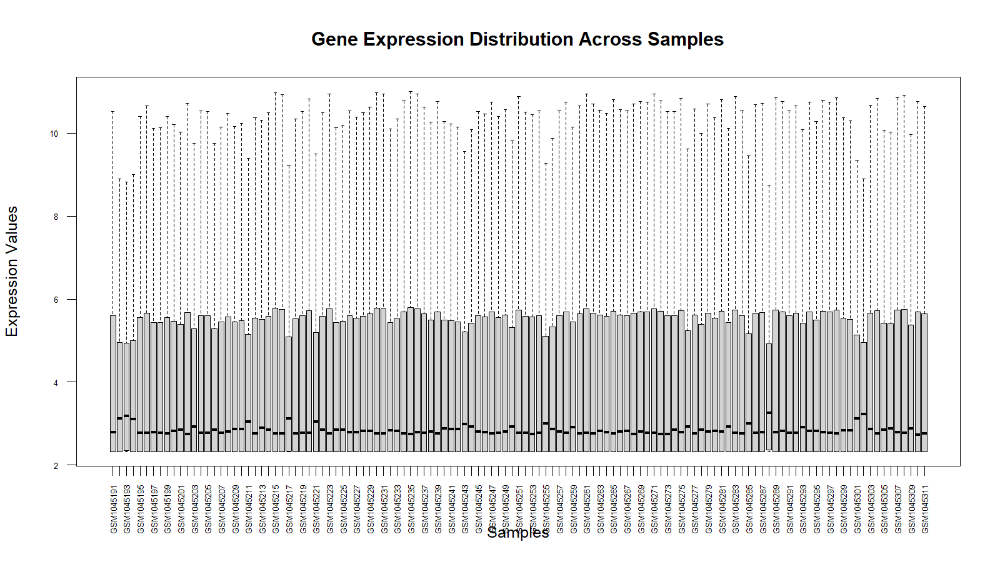
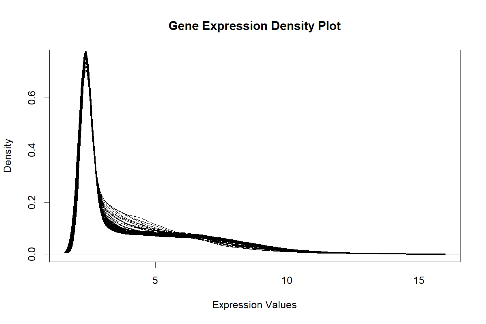
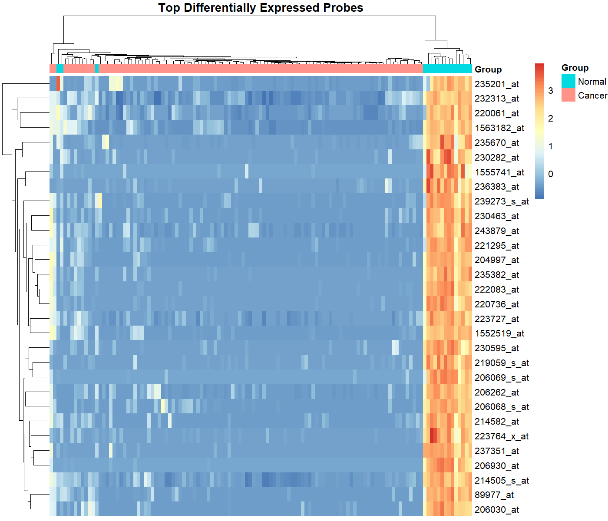
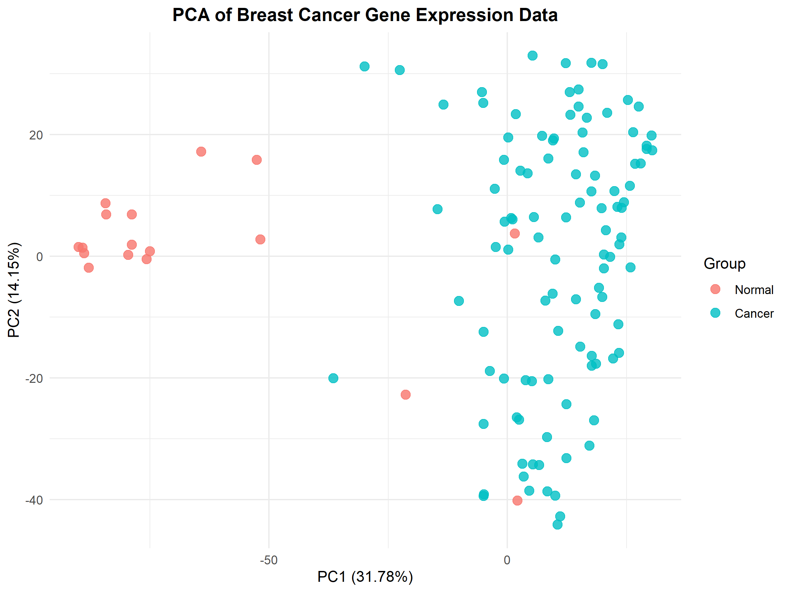
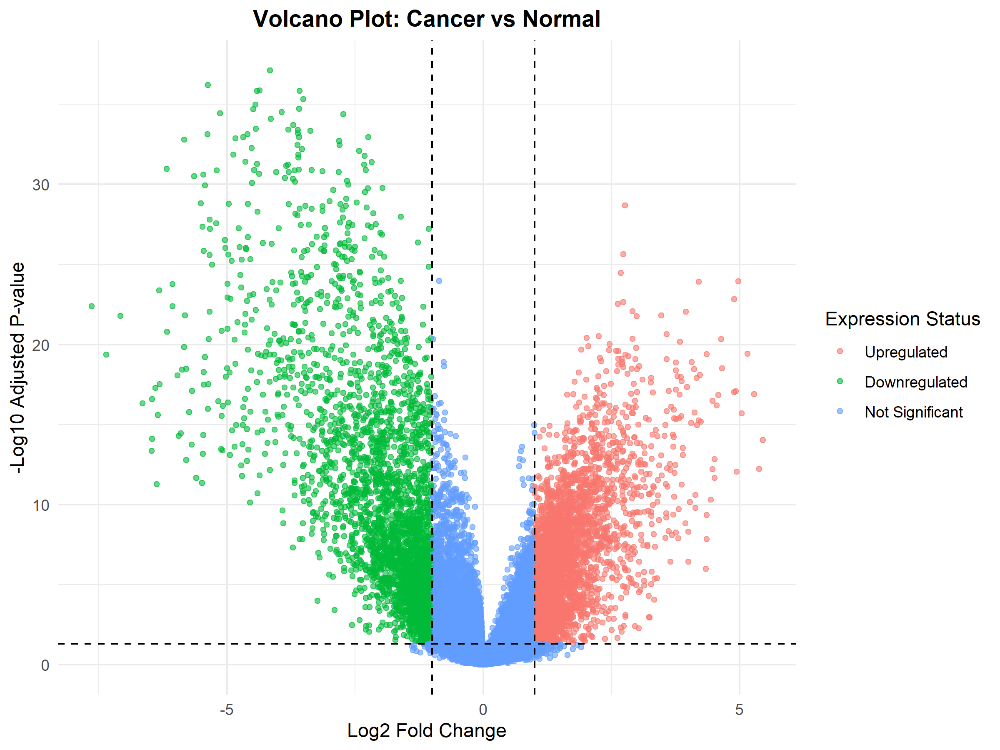
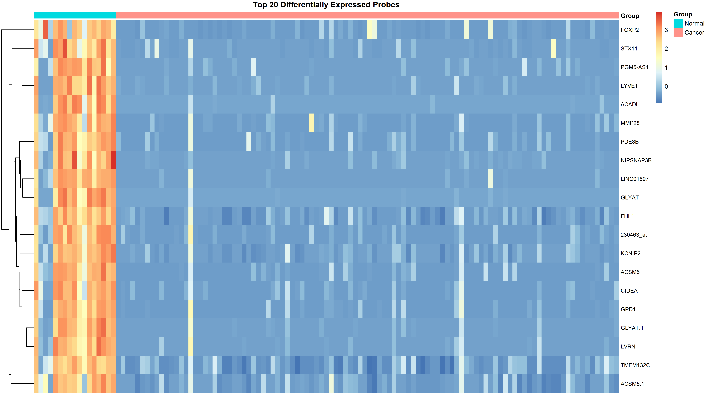
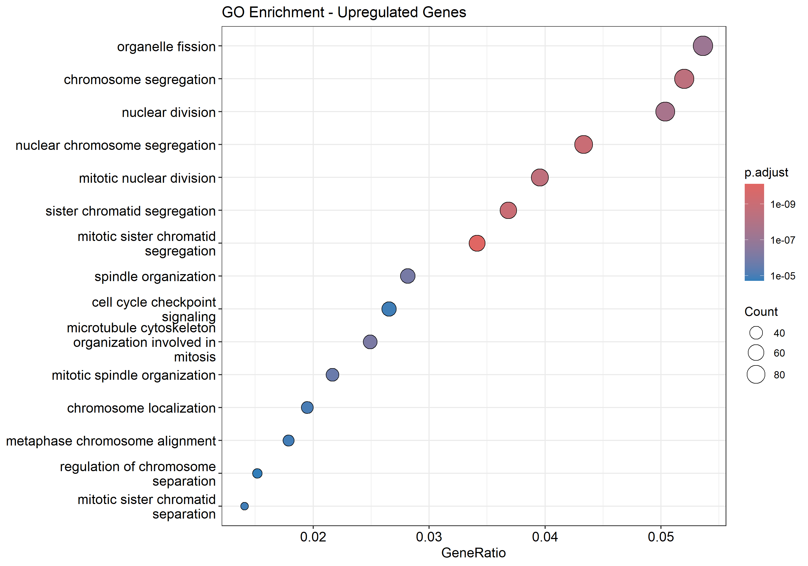
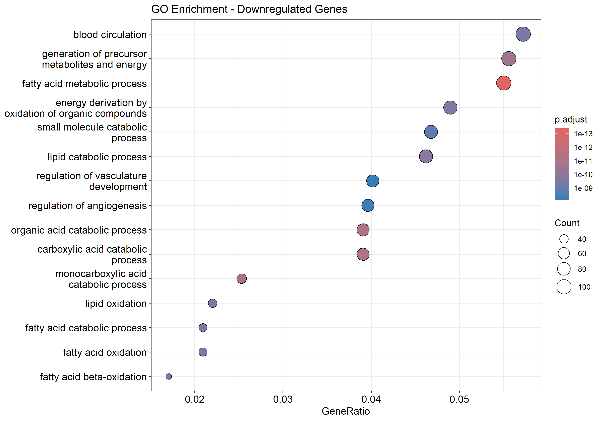

# Breast Cancer Gene Expression Analysis Using R

## Abstract

Breast cancer is a major health problem, and studying changes in gene activity can help researchers understand the biological processes associated with the disease. This project analysed the public gene expression dataset GSE42568 from the Gene Expression Omnibus (GEO) database. The analysis was carried out using the R programming language. Quality control, exploratory data analysis, differential expression analysis and Gene Ontology (GO) enrichment analysis were performed. A total of 54,675 probes were analysed, and 6,471 significant probes were identified. Among these, 3,386 were upregulated and 3,085 were downregulated in breast cancer samples. GO enrichment analysis identified biological processes mainly related to cell division, chromosome segregation, fatty acid metabolism and lipid catabolism.

## 1. Introduction

Breast cancer is one of the major types of cancer affecting women worldwide. It develops when cells in breast tissue grow and divide in an uncontrolled way. Understanding the biological changes associated with breast cancer is important for studying the disease.

Genes contain instructions that help cells perform their normal functions. Gene expression describes how much a gene is active in a cell or tissue. Gene expression levels can differ between normal and cancer tissues. Some genes may show higher expression in cancer tissue, while others may show lower expression. These changes are known as differential gene expression.

Bioinformatics provides tools and methods to analyse large biological datasets. Gene expression data can be analysed using statistical methods and visualisations to identify differences between groups of samples. Functional enrichment analysis can also be used to identify biological processes associated with selected genes.

The real-world problem addressed in this project is the identification of gene expression differences between breast cancer tissue and normal breast tissue. This project uses the GSE42568 dataset obtained from the National Centre for Biotechnology Information (NCBI) Gene Expression Omnibus (GEO) database.

**Aim**

The main aim of this project is to identify differentially expressed probes between breast cancer and normal breast tissue and to explore the biological processes associated with the upregulated and downregulated results.

**Objectives**

- To obtain a publicly available breast cancer gene expression dataset from GEO.
- To import and prepare the gene expression data using R.
- To perform quality control and exploratory data analysis.
- To identify differentially expressed probes between cancer and normal samples.
- To perform Gene Ontology enrichment analysis.
- To interpret the results in relation to breast cancer.

**Research Question**

Which gene expression probes show significant differences between breast cancer and normal breast tissue, and which biological processes are associated with these differences?

**Hypothesis**

Breast cancer samples have different gene expression patterns from normal breast tissue. These differences are associated with biological processes involved in cell activity and metabolism.

## 2. Data

### 2.1 Data Source

The dataset used in this project was obtained from the NCBI Gene Expression Omnibus (GEO) database. GEO is a public repository that stores biological data, including gene expression information.

The selected dataset is GSE42568.

| Feature | Description |
|---|---|
| Dataset ID | GSE42568 |
| Organism | Homo sapiens |
| Platform | GPL570 |
| Technology | Affymetrix Human Genome U133 Plus 2.0 Array |
| Total samples | 121 |
| Breast cancer samples | 104 |
| Normal breast tissue samples | 17 |
| Total expression probes | 54,675 |

Dataset link: https://www.ncbi.nlm.nih.gov/geo/query/acc.cgi?acc=GSE42568

### 2.2 Data Description

The dataset contains gene expression measurements from breast cancer and normal breast tissue samples. The expression data were used to compare the two sample groups and identify differences in gene activity.

The dataset contains two main types of information:

- **Expression data:** Gene expression measurements for the samples.
- **Sample information:** Details about the samples, including their tissue types.

The samples were divided into two groups: Cancer and Normal. These groups were used for the differential expression analysis.

### 2.3 Ethical Considerations

This project used an existing public dataset obtained from the GEO database. No new biological samples or personal information were collected from individuals. The data were used for educational and research purposes.

## 3. Methods

All analyses were performed using the R programming language in RStudio. The project followed a step-by-step bioinformatics workflow, including data collection, preprocessing, quality control, differential expression analysis and functional enrichment analysis.

### 3.1 Data Collection

The GSE42568 dataset was downloaded from the GEO database using the GEOquery package in R.

The downloaded expression set was saved as an RDS file so that it could be reused in later stages of the project without downloading the dataset again.

The expression matrix and sample information were extracted from the downloaded dataset.

### 3.2 Data Preprocessing

Data preprocessing was performed to prepare the dataset for further analysis.

The expression matrix and sample metadata were extracted separately. The tissue information in the sample metadata was used to identify the sample groups.

The samples were classified into two groups:

- Cancer
- Normal

The group information was converted into a factor in R. This allowed the two groups to be used in the statistical analysis.

### 3.3 Quality Control and Exploratory Data Analysis

Quality control was performed to examine the expression data before conducting the main analysis.

Several visualisation methods were used:

**Expression Boxplot**

The boxplot was used to compare the distribution of expression values across the samples. It helped to examine differences in the expression distributions.

**Expression Density Plot**

The density plot was used to examine the overall distribution of expression values across the samples.

**Sample Correlation Heatmap**

A correlation heatmap was generated to examine similarities between sample expression profiles. Samples with similar expression patterns may show higher correlation values.

**Principal Component Analysis (PCA)**

PCA was used to explore the variation in gene expression between samples. It helped to visualise the relationships between samples and identify possible grouping patterns.

Missing-value checks and sample counts were also examined during this stage.

### 3.4 Differential Expression Analysis

Differential expression analysis was performed using the limma package in R.

The main purpose of this analysis was to identify probes that showed significant expression differences between breast cancer and normal breast tissue.

A design matrix was created using the two sample groups. The comparison was defined as:

**Cancer - Normal**

The empirical Bayes method in limma was used to calculate statistical evidence for differences in expression.

The Benjamini-Hochberg method was used to adjust p-values for multiple testing. This is important because thousands of probes were analysed at the same time.

The following criteria were used to identify significant probes:

- Adjusted p-value < 0.05
- Absolute log fold change > 1

The results were classified into two categories:

- **Upregulated probes:** Probes with positive log fold-change values. These showed higher expression in cancer samples compared with normal samples.
- **Downregulated probes:** Probes with negative log fold-change values. These showed lower expression in cancer samples compared with normal samples.

A volcano plot was generated to visualise the differential expression results. A heatmap was also created to display selected top differentially expressed probes.

### 3.5 Gene Ontology Enrichment Analysis

Gene Ontology (GO) enrichment analysis was performed to identify biological processes associated with the upregulated and downregulated results.

Probe identifiers were mapped to Entrez Gene identifiers using the hgu133plus2.db annotation package.

The clusterProfiler package and org.Hs.eg.db annotation database were used for the enrichment analysis.

The analysis focused on the Biological Process (BP) category.

The Benjamini-Hochberg method was used for p-value adjustment. The enrichment results were examined separately for upregulated and downregulated gene lists.

GO enrichment analysis helps to identify biological processes that are represented in a selected gene list. It provides information about the possible biological functions associated with the results.

### 3.6 R Packages Used

The following R packages were used in this project:

| Package | Purpose |
|---|---|
| GEOquery | Downloading gene expression data from GEO |
| limma | Differential expression analysis |
| hgu133plus2.db | Affymetrix probe annotation |
| AnnotationDbi | Working with gene annotation data |
| clusterProfiler | GO enrichment analysis |
| org.Hs.eg.db | Human gene annotation |
| enrichplot | Visualisation of enrichment results |
| ggplot2 | Data visualisation |

## 4. Results

### 4.1 Summary of the Analysis

A total of 54,675 expression probes were analysed. Based on the selected significance criteria, 6,471 significant probes were identified.

The results are summarised below.

| Measure | Result |
|---|---:|
| Total probes analysed | 54,675 |
| Significant probes | 6,471 |
| Upregulated probes | 3,386 |
| Downregulated probes | 3,085 |
| Upregulated GO terms | 177 |
| Downregulated GO terms | 721 |

Among the significant probes, 3,386 were upregulated and 3,085 were downregulated in breast cancer samples compared with normal breast tissue.

These values represent probe counts, not necessarily unique gene counts, because multiple probes can represent the same gene.

### 4.2 Quality Control Results

Quality control visualisations were generated to examine the expression data.

**Expression Boxplot**



*Figure 1: Distribution of gene expression values across samples.*

**Expression Density Plot**



*Figure 2: Density distribution of gene expression values across samples.*

**Sample Correlation Heatmap**



*Figure 3: Correlation between sample expression profiles.*

**Principal Component Analysis**



*Figure 4: PCA plot showing the variation between samples.*

These visualisations were used to explore the expression distributions, sample relationships and overall variation in the dataset.

### 4.3 Differential Expression Results

Differential expression analysis identified 6,471 significant probes using the selected adjusted p-value and log fold-change criteria.

Among these probes:

- 3,386 probes were upregulated in breast cancer samples.
- 3,085 probes were downregulated in breast cancer samples.

The volcano plot shows the relationship between the log fold change and adjusted p-value of the analysed probes.

**Volcano Plot**



*Figure 5: Volcano plot showing differentially expressed probes between cancer and normal samples.*

**Top Differentially Expressed Probes**



*Figure 6: Heatmap showing the expression patterns of selected top differentially expressed probes.*

### 4.4 GO Enrichment Results

GO enrichment analysis was performed separately for the upregulated and downregulated results.

The analysis identified:

- 177 enriched biological process terms for the upregulated results.
- 721 enriched biological process terms for the downregulated results.

**Upregulated GO Results**

The top enriched biological processes were mainly related to cell division and chromosome organisation.

Some of the important terms included:

- Mitotic sister chromatid segregation
- Nuclear chromosome segregation
- Sister chromatid segregation
- Mitotic nuclear division
- Chromosome segregation
- Nuclear division
- Organelle fission
- Spindle organisation

These results indicate that the upregulated list was mainly associated with biological processes involved in cell division and chromosome separation.



*Figure 7: GO enrichment results for upregulated genes.*

**Downregulated GO Results**

The top enriched biological processes were mainly related to fatty acid metabolism, lipid breakdown and energy production.

Some of the important terms included:

- Fatty acid metabolic process
- Organic acid catabolic process
- Carboxylic acid catabolic process
- Monocarboxylic acid catabolic process
- Lipid catabolic process
- Lipid oxidation
- Fatty acid beta-oxidation
- Fatty acid catabolic process

These results indicate that the downregulated list was mainly associated with metabolic processes, particularly those involving fatty acids and lipids.



*Figure 8: GO enrichment results for downregulated genes.*

## 5. Discussion

This project analysed gene expression differences between breast cancer and normal breast tissue using the GSE42568 dataset.

The differential expression analysis identified 6,471 significant probes. Among them, 3,386 were upregulated and 3,085 were downregulated in cancer samples.

The upregulated GO results were mainly related to cell division, chromosome segregation and mitotic processes. These processes are involved in cell growth and cell division. Their enrichment among the upregulated results suggests that genes associated with cell division were more active in the cancer samples.

The downregulated GO results were mainly related to fatty acid metabolism, lipid breakdown and energy-related processes. This suggests that the expression patterns of genes involved in these metabolic processes differed between cancer and normal samples.

Overall, the results show differences in gene expression between breast cancer and normal breast tissue. The combination of differential expression analysis and GO enrichment analysis helped to identify both expression changes and the biological processes associated with them.

However, these findings show associations and do not prove that the identified genes or biological processes directly cause breast cancer.

### 5.1 Limitations

There are several limitations in this project.

1. **Single dataset:** Only one GEO dataset was used. The results should be compared with other independent datasets before making wider conclusions.
2. **Microarray technology:** The analysis used data generated from the GPL570 microarray platform. Therefore, the results are limited to the probes available on this platform.
3. **Probe annotation:** Multiple probes may represent the same gene. Therefore, the number of significant probes should not be considered the number of unique genes.
4. **Statistical thresholds:** The results depend on the selected adjusted p-value and log fold-change thresholds. Different thresholds may produce different results.
5. **GO enrichment:** The enrichment results depend on the selected gene lists and annotation database. They do not prove a causal relationship.
6. **No independent validation:** The identified results were not experimentally validated or tested using a separate patient dataset.

These limitations should be considered when interpreting the findings.

## 6. Conclusion and Future Work

This project successfully applied a bioinformatics workflow in R to analyse breast cancer gene expression data from the GSE42568 dataset.

The analysis included data collection, preprocessing, quality control, exploratory data analysis, differential expression analysis and GO enrichment analysis.

A total of 54,675 probes were analysed, and 6,471 significant probes were identified. Among them, 3,386 were upregulated and 3,085 were downregulated in breast cancer samples compared with normal breast tissue.

GO enrichment analysis identified 177 biological process terms associated with the upregulated results and 721 terms associated with the downregulated results.

The upregulated results were mainly related to cell division and chromosome segregation. The downregulated results were mainly related to fatty acid metabolism and lipid catabolism.

In future work, the results could be compared with other breast cancer datasets. Selected candidate genes could also be investigated further using independent datasets. Additional analysis could include breast cancer subtypes and clinical information if suitable data are available.

## 7. Reproducibility

The project is organised into separate R scripts in the `code/` folder. Each script performs a specific stage of the analysis.

The scripts should be executed in the following order:

| Script | Description |
|---|---|
| 01_data_collection.R | Downloads and saves the GSE42568 dataset |
| 02_data_preprocessing.R | Prepares the expression data and sample groups |
| 03_quality_control.R | Performs quality control and creates visualisations |
| 04_differential_expression.R | Performs differential expression analysis |
| 05_functional_enrichment.R | Performs GO enrichment analysis |
| 06_results_summary.R | Creates the final results summary |

### How to Run the Project

1. Install R and RStudio.
2. Download or clone this GitHub repository.
3. Open the project folder in RStudio.
4. Install the required R packages if they are not already installed.
5. Run the R scripts in the order shown above.
6. Check the generated tables in `results/tables/`.
7. Check the generated figures in `results/figures/`.

An internet connection is required when downloading the GEO dataset.

The `data/` folder is excluded from Git tracking. Therefore, the dataset should be downloaded by running the data collection script.

The R environment and installed package versions can be checked using:

```r
sessionInfo()
```

The analysis scripts and generated results are stored in the GitHub repository to support reproducibility.

## 8. References

1. Edgar, R., Domrachev, M. and Lash, A.E. (2002). Gene Expression Omnibus: NCBI gene expression and hybridisation array data repository. *Nucleic Acids Research*, 30(1), pp. 207–210. https://doi.org/10.1093/nar/30.1.207

2. National Center for Biotechnology Information (NCBI). *GSE42568: Gene Expression Omnibus dataset*. Available at: https://www.ncbi.nlm.nih.gov/geo/query/acc.cgi?acc=GSE42568

3. Ritchie, M.E. et al. (2015). limma powers differential expression analyses for RNA-sequencing and microarray studies. *Nucleic Acids Research*, 43(7), e47. https://doi.org/10.1093/nar/gkv007

4. Yu, G., Wang, L.G., Han, Y. and He, Q.Y. (2012). clusterProfiler: an R package for comparing biological themes among gene clusters. *OMICS: A Journal of Integrative Biology*, 16(5), pp. 284–287. https://doi.org/10.1089/omi.2011.0118

5. Bioconductor. *GEOquery: Get data from the NCBI Gene Expression Omnibus (GEO)*. Available at: https://bioconductor.org/packages/GEOquery/

6. Bioconductor. *limma: Linear Models for Microarray Data*. Available at: https://bioconductor.org/packages/limma/

7. Bioconductor. *clusterProfiler: Statistical analysis and visualisation of functional profiles for genes and gene clusters*. Available at: https://bioconductor.org/packages/clusterProfiler/

8. Bioconductor. *org.Hs.eg.db: Genome-wide annotation for Human*. Available at: https://bioconductor.org/

---

## 9. Project Structure

```text
Breast-Cancer-Gene-Expression/
│
├── README.md
├── .gitignore
│
├── code/
│   ├── 01_data_collection.R
│   ├── 02_data_preprocessing.R
│   ├── 03_quality_control.R
│   ├── 04_differential_expression.R
│   ├── 05_functional_enrichment.R
│   └── 06_results_summary.R
│
├── data/
│
└── results/
    ├── figures/
    │   ├── expression_boxplot.png
    │   ├── expression_density.png
    │   ├── sample_correlation_heatmap.png
    │   ├── pca_plot.png
    │   ├── volcano_plot.png
    │   ├── top_genes_heatmap.png
    │   ├── upregulated_GO_plot.png
    │   └── downregulated_GO_plot.png
    │
    └── tables/
        ├── all_differential_expression_results.csv
        ├── significant_genes.csv
        ├── upregulated_GO_enrichment.csv
        ├── downregulated_GO_enrichment.csv
        └── final_results_summary.csv
```
